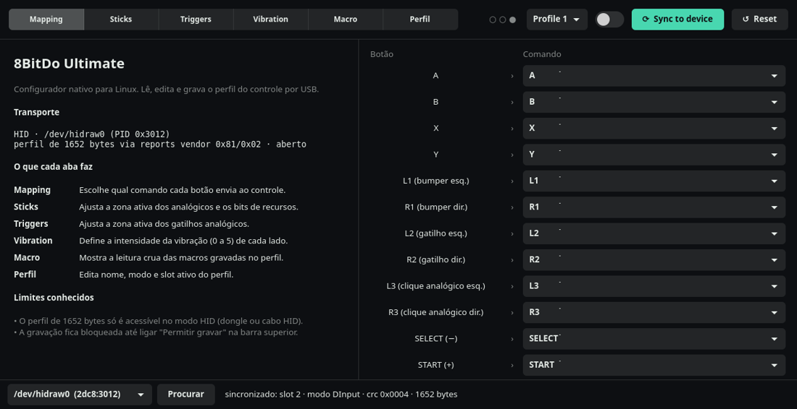

# openbitdo

Native Linux configuration tool for the **8BitDo Ultimate** controller.
GTK4 interface, written in C23. No Wine, no emulation layer.

The official 8BitDo software is Windows-only and requires Windows HID APIs.
This project speaks the same vendor HID protocol directly on Linux via `hidraw`.



## Features

- Read and **write the full 1652-byte profile record** (persisted in the controller).
- Three profile slots: name (UTF-16), gamepad mode (Switch / DInput / XInput), active slot.
- Button mapping for all 20 inputs, including the two rear paddles **P1 / P2**.
- Stick and trigger active ranges, vibration levels per side, macro record (read-only).
- Explanatory panel showing the detected transport and what each tab does.
- CLI tools: `bd_cli` (dump/write/list/info), `bd_build` (record generator), `bd_watch` (live buttons).

## Requirements

- A controller exposing the **HID vendor channel**: DInput / "Ultimate Software" mode
  (`2dc8:3012`, and the `0x3100`/`0x3104`/`0x3105` software PIDs).
  In **XInput** mode (`2dc8:3106`) the device exposes a single vendor interface
  `0xFF/0x5D/0x01` with no HID, so the profile is not reachable — same limitation as
  the official app, which also waits for a HID-capable device.
- Read/write access to `/dev/hidraw*` for your user (see `docs/udev.md`).

## Build

Needs GCC with C23 support (GCC 14+) and GTK4 development headers.

```bash
sudo apt install build-essential libgtk-4-dev
make            # builds build/8bdgui, build/bd_cli, build/bd_build, build/bd_watch
make test       # 275 core checks + tool tests + window smoke test
```

## Usage

```bash
./build/8bdgui
```

Workflow: **Ler perfil** → edit → enable **Permitir gravar** → **Sync to device**.
Writing is blocked by default; the switch is the safety interlock.

Command line:

```bash
build/bd_cli list                 # enumerate 2dc8 hidraw devices
build/bd_cli dump backup.bin      # read the 1652-byte record
build/bd_cli write backup.bin --verify
build/bd_build custom.bin --mode 1 --slot 0 --p1 A --p2 B
build/bd_watch                    # live button state (HID report id 3)
```

## AppImage

```bash
make appimage     # produces openbitdo-x86_64.AppImage
./openbitdo-x86_64.AppImage
```

The AppImage bundles the binaries and links against the system GTK4.

## How the protocol was recovered

No code from the original software is used. Everything below was obtained by static
analysis and then verified against real hardware:

- **Ghidra 12.1.4** (driven through [REA](https://github.com/morluto/rea)) was used to
  decompile the native `8BitDoAdvance.dll` (PE32, MFC debug build, no PDB):
  HID open/write/read wrappers, the 16-byte transfer header builder, the response
  parser, the CRC routine and the profile read/write loops.
- The managed assembly (`8BitDo Ultimate Software.exe`, .NET 4.5) provided the struct
  layout through its metadata: field offsets, array sizes, the 18 named keys plus
  `P1`/`P2`, the action bitmasks and the per-PID gating.
- The HID report descriptor was read from the device itself
  (`INPUT report 0x02`, `OUTPUT report 0x81`, 63 bytes each).

Facts that only the hardware could settle, and that differ from a naive reading of the
binary:

| field | naive reading | measured behaviour |
|---|---|---|
| `crc_value` (0x00C) | CRC-16 of the record | **device-managed counter** — the device overwrites whatever is sent |
| `cur_slot` (0x012) | active slot 0..2 | stays `4` (sentinel) unless the app activates a slot |
| header CRC (+6) | always present | only for a fixed PID list; `0x3012` has none |

See `docs/protocol.md` for the full wire format.

## Layout

```
native/    the GTK4 app and the protocol core
  bd_core.[ch]   protocol constants, record layout, CRC, framing helpers (no I/O)
  bd_hid.[ch]    hidraw transport: frame build, ACKs, chunked read/write
  8bdgui.c       GTK4 interface
linux/     command line tools
  bd_cli.c  bd_build.c  bd_watch.c
native/tests/    unit tests and the regression suite
docs/      protocol notes, udev rule, Hyprland notes
```

## Known limitations

- Firmware update is not implemented.
- Macros are read but not editable.
- The device keeps `cur_slot = 4`; slot activation depends on the controller.
- XInput mode is not supported for configuration (no HID channel).

## License

MIT. `8BitDo` and the controller artwork are trademarks of their owner; no vendor
binary or asset is distributed in this repository.
